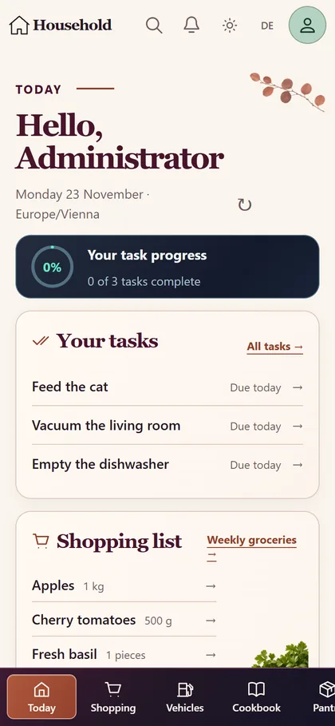
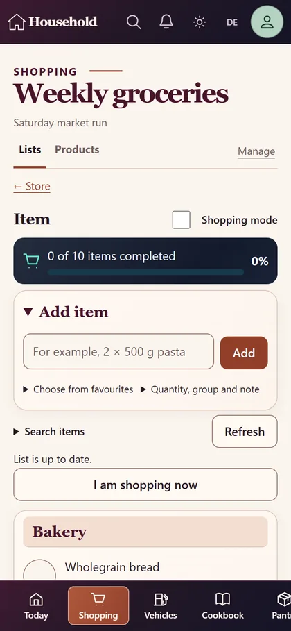
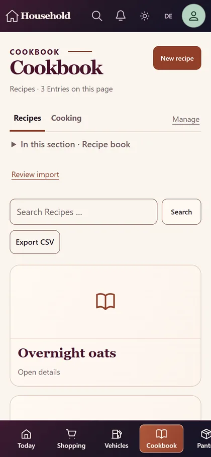
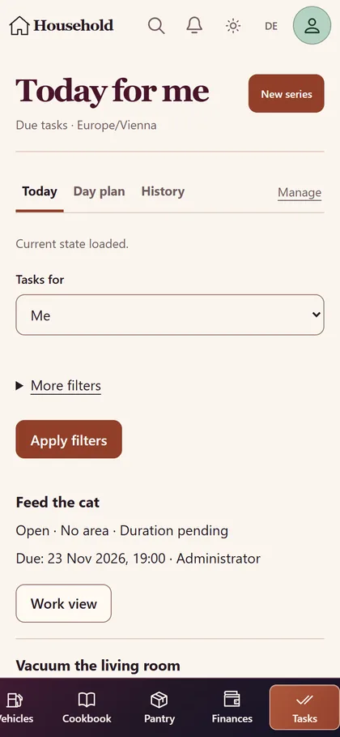
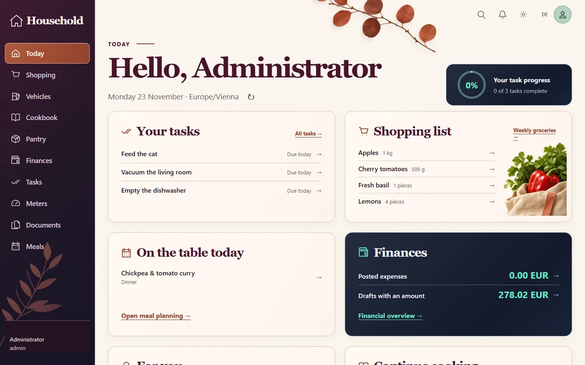
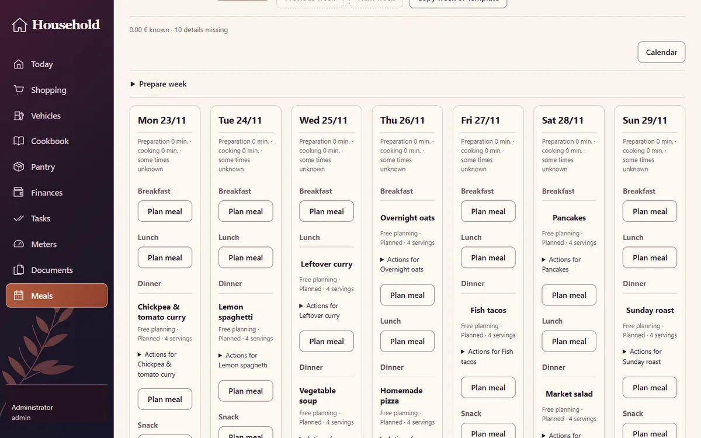

<div align="center">


# Household

**A self-hosted household app for everyday planning.** Shopping, vehicles, recipes,
pantry, finances and optional modules share one mobile-first PWA. Go serves the
interface and API from one binary; PostgreSQL holds the data; Docker Compose runs it.

[](https://github.com/d0linger/Household/actions/workflows/release.yml)
[](https://github.com/d0linger/Household/actions/workflows/quality.yml)
[](https://github.com/d0linger/Household/actions/workflows/browser.yml)
[](LICENSE)


</div>

Household keeps the everyday organisation of one home in one place: what to buy,
what is in the cupboard, what to cook this week, who does which chore, what the car
consumes, what the meters read, which documents expire and where the money went.
Five modules start enabled; administrators switch on the other four, and pausing a
module keeps its data. One installation serves one household.

> The interface is available in **German** and **English**; this README is in English.
>
> Frontend scripts, styles, fonts and icons are served **locally**: no CDN, no
> tracking, a restrictive CSP. Your data stays on your server.

`dev` is the development branch; checked `dev` → `main` pull requests feed the
production image. Publishing an image does not deploy an installation. The
[release procedure](docs/release-process.md) explains the gates and rollback.

---

## 📸 Screenshots

> The screenshots follow your theme: **light on GitHub's light theme, dark on its dark theme**.
> They show the Warm Midnight palette in English with invented demo data from a
> disposable test instance, never a real household.

<table>
<tr>
<td align="center"><b>Today</b></td>
<td align="center"><b>Shopping</b></td>
<td align="center"><b>Cookbook</b></td>
<td align="center"><b>Tasks</b></td>
</tr>
<tr>
<td><picture><source media="(prefers-color-scheme: dark)" srcset="docs/img/today-m-dark.webp"></picture></td>
<td><picture><source media="(prefers-color-scheme: dark)" srcset="docs/img/shopping-m-dark.webp"></picture></td>
<td><picture><source media="(prefers-color-scheme: dark)" srcset="docs/img/cookbook-m-dark.webp"></picture></td>
<td><picture><source media="(prefers-color-scheme: dark)" srcset="docs/img/tasks-m-dark.webp"></picture></td>
</tr>
</table>

<p align="center"><b>Today</b> — personal tasks, the active shopping list, today's meal and the financial summary on one page</p>
<p align="center"><picture><source media="(prefers-color-scheme: dark)" srcset="docs/img/today-dark.webp"></picture></p>

<p align="center"><b>Meal planning</b> — a week of breakfasts, lunches and dinners with portions and planning status</p>
<p align="center"><picture><source media="(prefers-color-scheme: dark)" srcset="docs/img/mealplan-dark.webp"></picture></p>

---

## ✨ Modules

| Area | What it covers |
| --- | --- |
| **Today** | Personal attention items, active cooking and household-day meals. |
| **Shopping** | Shared lists, quantities, ordering, reviewed imports and exports, barcode and repurchase suggestions. |
| **Vehicles** | Fuel and odometer records, maintenance, exact consumption and optional expense handoff. |
| **Recipes** | Versioned recipes, cooking sessions and timers, reviewed stock use and Shopping transfer. |
| **Pantry** | Products, locations, dated lots, stock movements, shortages and expiry review. |
| **Finance** | Exact money, private access, budgets, accounts, receipts, reviewed imports and immutable postings. |
| **Meal Planning** | Week and agenda views, portions, participants, stock demand and reviewed purchases. |
| **Chores** | Assignments, schedules, rotations, history and personal day plans. |
| **Meters** | Readings, physical replacements, tariffs, bills and optional Home Assistant/MQTT adapters. |
| **Documents** | Inbox, preserved originals, scans, local PDF/OCR review, deadlines and protected search. |

- **Enabled at first start:** Shopping, Vehicles, Recipes, Pantry and Finance.
  Administrators can enable Meal Planning, Chores, Meters and Documents without
  deleting their data when paused. Optional integrations are disabled until
  configured and approved.
- **Scope and evidence:** the [180-item checklist](docs/taskliste.md) and the
  [module acceptance records](docs/improvements-180.md) track the implemented scope
  and its verification.
- **Appearance:** Warm Midnight and Pink families, each with Light, Dark and System
  appearance. Settings and security deliberately use the dark Midnight Atlas
  palette; the right account menu stays plum/copper. See the
  [design system](DESIGN.md), the [rollout checklist](docs/warm-midnight-rollout.md)
  and the [Warm Midnight visual review](docs/visual-fidelity.md), which maps the 17
  reference screens to the household views, the administrative pages and the
  account menu, and documents the local assets and the provenance of recipe images.
- **Navigation:** members order their own module navigation. On phones, swipe the
  bottom rail for more modules and expand the section menu for secondary views.
- **PWA:** the app caches public assets and an offline shell; private API responses
  are not cached. Installed on a phone, it accepts photos and PDFs from the system
  share sheet.
- **Notifications:** require account and device consent. Physical push delivery on
  Windows, Android and iOS still needs testing against a device-reachable HTTPS
  installation; see the [notification record](docs/notifications-implementation.md).

---

## 🚀 Quick start (Docker Compose)

Requirements: Docker Engine with Compose v2 (rootful or
[rootless](docs/installation.md#rootless-docker)). No source code, Go or scripts are
needed. [`compose.yaml`](compose.yaml) is the only deployment file. A step-by-step
guide in German is in [docs/installation.md](docs/installation.md).

```sh
curl -fsSLO https://raw.githubusercontent.com/d0linger/Household/main/compose.yaml
(umask 077; set -C; docker run --rm ghcr.io/d0linger/household:production init > .env)
# set HOUSEHOLD_ORIGIN in .env; for a local trial use "init --development" instead
docker compose up -d
```

`umask 077` keeps `.env` readable only by your user, and `set -C` refuses to
overwrite an existing `.env`, whose keys an installation needs; delete an empty
`.env` left by a failed run before retrying. `household init` writes one `.env` with
every setting and freshly generated password and key, including the Web Push key.
It never prints them to a terminal. **Back up `.env` separately:** without it,
encrypted data and backups cannot be read.

`docker compose up -d` then starts three services:

| Service | Role |
| --- | --- |
| `db` | PostgreSQL, without a published port. |
| `app` | Its `start` command creates the database roles as the PostgreSQL superuser, migrates as the owner and serves as the restricted app role on `127.0.0.1:8100`. |
| `backup` | Encrypted restic snapshots on the schedule administrators set under **Settings → Backup** (daily at 03:00 by default), optional offsite copies, restore tests, and the backups, checks and live restores administrators request in the app. It alone holds repository and owner credentials; the app only records requests. It is also the owner-credential maintenance service, e.g. `docker compose run --rm --no-deps backup recover admin`. |

Open the configured origin and sign in as `admin` with `HOUSEHOLD_ADMIN_PASSWORD`;
you change it at first sign-in.

**For production**, put an HTTPS reverse proxy in front, set the exact
`HOUSEHOLD_ORIGIN` and `HOUSEHOLD_TRUSTED_PROXIES`, and verify an encrypted backup
(see [Backup and restore](#-backup-and-restore)). The app supports one instance per
household and one application replica.

**Images:** the published image is `ghcr.io/d0linger/household:production` (also
`:latest`). It is built from the `ocr` target and includes Tesseract, `restic` and
the PostgreSQL 18 client. Pin a deployment to a verified digest rather than a mutable
tag. To run a local build instead, use `docker build --target ocr -t household:local .`
and set `HOUSEHOLD_IMAGE=household:local` in `.env`. No workflow deploys to a server.

---

## 🧩 Features that switch on by configuration

- **OCR:** local Tesseract with German/English data. It is on whenever the image
  contains it, unless `HOUSEHOLD_OCR_ENABLED=false`. Existing PDF text is preferred;
  extracted values remain subject to review.
- **Web Push:** on when `HOUSEHOLD_WEB_PUSH_VAPID_PRIVATE_KEY` is set (`init`
  generates it), unless `HOUSEHOLD_WEB_PUSH_ENABLED=false`. The contact defaults to
  the HTTPS origin. Device delivery needs a reachable HTTPS origin and explicit user
  consent; see [Web Push operations](docs/operations.md#device-notifications).
- **Documents inputs and meter adapters:** fill in their lines in section 4 of
  `.env` (IMAP, Paperless, Home Assistant, MQTT), then approve them in the app. A
  scanner folder is enabled by uncommenting its line under `app.volumes` in
  `compose.yaml`. For a private meter CA, add
  `- ./meters-ca.pem:/config/meters-ca.pem:ro` under `app.volumes` and set
  `HOUSEHOLD_METERS_CA_FILE=/config/meters-ca.pem` in `.env`.

All nine modules run inside the single `app` service; administrators enable
optional modules in the app.

---

## ⚙️ Configuration

`.env` is the only configuration file. The principal settings are:

| Setting | Purpose |
| --- | --- |
| `HOUSEHOLD_ENV` | `production` or explicitly `development`; production requires HTTPS. |
| `HOUSEHOLD_ORIGIN` | Exact external browser origin; also used for passkeys and push. |
| `HOUSEHOLD_PORT` | Local published port, default `8100`. |
| `HOUSEHOLD_TRUSTED_PROXIES` | Exact proxy CIDRs; empty trusts none. |
| `HOUSEHOLD_ADMIN_USERNAME` / `_PASSWORD` | Bootstrap account; change the password at first sign-in. |
| `HOUSEHOLD_IMAGE` | Image to run, default `ghcr.io/d0linger/household:production`. |
| `HOUSEHOLD_OFF_ENABLED` | Optional product suggestions, off by default. |
| `HOUSEHOLD_BACKUP_OFFSITE_REPOSITORY` / `_PASSWORD` | Optional offsite restic repository (`s3:https://host/bucket/prefix`, `rest:https://host/path` or an absolute path) and its own password; only the backup service reads them. |
| `HOUSEHOLD_BACKUP_S3_ACCESS_KEY_ID` / `_SECRET_ACCESS_KEY` / `_REGION` | Credentials for an `s3:` offsite repository. `HOUSEHOLD_BACKUP_REST_USERNAME` / `_PASSWORD` serve a `rest:` repository. |
| `HOUSEHOLD_ALERT_NTFY_URL`, `HOUSEHOLD_ALERT_WEBHOOK_URL`, `HOUSEHOLD_ALERT_SMTP_*` | Optional external warnings from the backup service (ntfy, webhook or e-mail over TLS). |
| `HOUSEHOLD_METRICS_TOKEN` | Enables `/metrics` for Prometheus; see [monitoring](docs/monitoring/README.md). |
| `HOUSEHOLD_UPDATE_CHECK` | `true` asks GitHub at most once a day whether a newer revision exists; shown on the system page. Off by default. |
| `HOUSEHOLD_PASSWORD_BREACH_CHECK` | `true` refuses new passwords listed in Have I Been Pwned, using the k-anonymous range API. Off by default; an unreachable service accepts the password. |

**Generated values** (`POSTGRES_PASSWORD`, `HOUSEHOLD_OWNER_PASSWORD`,
`HOUSEHOLD_APP_PASSWORD`, CSRF/rate/encryption keys, the VAPID key and
`RESTIC_PASSWORD`) must not be changed casually. Never commit `.env`,
`.local/secrets`, uploads or backup repositories.

**Database connection:** with `compose.yaml`, `app` and `backup` connect to
`db:5432/household` with the role passwords from `.env`; do not set
`HOUSEHOLD_DATABASE_URL` there. `HOUSEHOLD_DATABASE_URL` is for running
`household serve` or maintenance commands outside this Compose file, and then
without `HOUSEHOLD_DATABASE_PASSWORD` (an explicit setting wins over a file in
`/run/secrets`, two explicit sources are refused).

**Secrets as files:** every `HOUSEHOLD_<NAME>` secret also accepts
`HOUSEHOLD_<NAME>_FILE` or a file `/run/secrets/<name>`, for operators who mount
secrets as files. `RESTIC_PASSWORD` also accepts `RESTIC_PASSWORD_FILE` or
`/run/secrets/restic_password`. `start` removes every backup repository credential
(`RESTIC_PASSWORD*`, `HOUSEHOLD_BACKUP_OFFSITE_*`, `HOUSEHOLD_BACKUP_S3_*`,
`HOUSEHOLD_BACKUP_REST_*`) before the web process runs, so only the backup service
can use them.

<details>
<summary>Keeping the repository password in a file</summary>

1. Save the existing repository password and keep a separate copy for recovery.
2. Make it readable only by the container user:
   `chmod 0400 restic_password && sudo chown 10001 restic_password`
   (with rootless Docker, use the UID that 10001 maps to).
3. Mount it read-only on `backup`:
   `- ./restic_password:/run/secrets/restic_password:ro` under `backup.volumes`.
4. Set `RESTIC_PASSWORD_FILE=/run/secrets/restic_password` there and remove
   `RESTIC_PASSWORD` from `.env`.

</details>

**Passkeys** need the configured HTTPS hostname, or `localhost` in development.
Numeric IP origins cannot enroll passkeys. Password, TOTP and recovery codes remain
available. Warm Midnight/Pink and DE/EN require no external assets or translation
service. See [operations](docs/operations.md) for key rotation, restore and full
configuration.

---

## 💾 Backup and restore

Administrators manage backups in the app under **Settings → Backup**: the health of
the local and offsite targets, the last restore test, every restore point and the
history of requested and scheduled work. Buttons there *request* work (back up now,
test the offsite connection, verify or restore a restore point); the `backup`
service claims each request and checks it again with its own privileges.

- **What a snapshot holds:** a PostgreSQL dump, a schema/file-hash manifest and the
  security-key bundle together with the uploaded files, encrypted with restic.
- **Schedule and retention:** daily at 03:00 in the household zone by default, with
  7 daily / 4 weekly / 12 monthly local snapshots and a weekly automatic restore
  test.
- **Offsite:** local snapshots do not protect against loss of the whole host. Set
  `HOUSEHOLD_BACKUP_OFFSITE_REPOSITORY` to S3-compatible storage (AWS, Backblaze B2,
  Wasabi, Hetzner, MinIO …), a restic REST server or a mounted path. Each run copies
  the new snapshot and checks a rotating sixth of the offsite data instead of
  downloading everything daily. Credentials inside the repository URL are refused.
- **Warnings:** administrators get an in-app notice when a backup or offsite copy
  fails, is overdue or has not been restore-tested. The service's container
  healthcheck runs `household backup-health`, and the optional ntfy, webhook or
  e-mail alerts report failures outside the app.

```sh
docker compose run --rm --no-deps backup backup                 # local snapshot
docker compose run --rm --no-deps backup backup --offsite       # plus offsite copy
docker compose run --rm --no-deps backup restore-check latest   # verify without touching live data
```

**Restore verification** restores into a temporary database of its own
(`household_restore_auto_…`) on the same server and then drops it. If the process is
killed or the server connection fails, that cleanup can be skipped or fail; the next
automatic check removes such leftovers once they are older than six hours. An
explicit `HOUSEHOLD_RESTORE_DATABASE_URL` target is never dropped.

**Live restore** is available to administrators after confirming their sign-in and
typing the phrase the page shows (`WIEDERHERSTELLEN <first 8 characters>`), and to
operators with
`docker compose run --rm --no-deps backup restore [--offsite] FULL_SNAPSHOT_ID --confirm "WIEDERHERSTELLEN …"`.
Household first takes a safety backup, fully verifies the snapshot in a staging
database, pauses the app briefly and then switches. Everyone signs in again. The
previous state is kept until an administrator discards it;
`backup restore-rollback` switches back. Restoring always needs the backup **and**
the `.env`. See [live restore](docs/operations.md#live-restore) and
[disaster recovery](docs/operations.md#disaster-recovery).

---

## ⬆️ Upgrades

If you pinned `HOUSEHOLD_IMAGE` to a digest in `.env`, first replace that digest
with the digest of the release you are installing; otherwise the commands below keep
the old version.

```sh
docker compose pull
docker compose up -d
```

Migrations run automatically at start. They are embedded, checksum-checked,
forward-only and versioned per schema; there are no automatic down migrations.

- Read the release notes first and keep the last verified backup until the new
  version runs. To control updates exactly, pin the image by digest: set
  `HOUSEHOLD_IMAGE=ghcr.io/d0linger/household@sha256:…` in `.env`. `compose.yaml`
  uses that value instead of its `:production` default, also when `.env` already
  overrides the image.
- For incompatible maintenance, follow the
  [upgrade and rollback procedure](docs/operations.md#upgrades-and-rollback): take a
  final backup with the old release, verify it, and migrate a restored copy with the
  candidate first.
- Rollback means restoring the verified pre-upgrade database, uploads and security
  keys, or a compatible forward repair. An older binary against a newer schema fails
  readiness rather than guessing compatibility.
- Installations from before the single `compose.yaml` (several Compose files with
  `.local/secrets`) move their secret values into `.env`; follow
  [the migration steps](docs/installation.md#umstieg-von-einer-älteren-installation-mit-localsecrets).

---

## 👥 Roles and permissions

| Action | Reader | Editor | Admin |
| --- | :---: | :---: | :---: |
| Read active modules, files and search | ✓ | ✓ | ✓ |
| Write household records | – | ✓ | ✓ |
| Own password, TOTP, sessions and preferences | ✓ | ✓ | ✓ |
| Toggle modules, manage users, request purge | – | – | ✓ (recent sign-in for sensitive actions) |
| Request backups, restore tests and live restores; change the schedule | – | – | ✓ |

Purge, recovery, backup and restore themselves have no HTTP endpoint; only the owner
`backup` service or the operator CLI executes them. Administrators can require a
second factor for administrators and optionally editors under
**Settings → Security**. See the [security design](docs/security.md) for the full
matrix.

---

## 📈 Health and metrics

| Endpoint | Purpose |
| --- | --- |
| `GET /health/live` | The process is alive. |
| `GET /health/ready` | Every expected schema version, read-only migration ledgers for the runtime role and the module contracts. One inspection runs at a time; its result is cached for five seconds. |
| `GET /metrics` | Prometheus series: requests by route, panics, sign-in protection, workers, database pool and backup state. Hidden unless `HOUSEHOLD_METRICS_TOKEN` is set; send the token in `X-Metrics-Token`, never in the URL. |

`docker compose exec app household healthcheck` probes readiness inside the
container. [Monitoring](docs/monitoring/README.md) lists every series and ships
[example alert rules](docs/monitoring/prometheus-alerts.yml).

---

## 🔒 Security

- **Accounts:** passwords use bcrypt; sessions are stored as hashes and can be
  revoked. TOTP with single-use recovery codes and passkeys are available.
- **Requests:** state-changing requests require CSRF protection; HTTP responses use
  a restrictive CSP and related headers. PostgreSQL holds durable rate limits.
- **History:** financial and stock corrections append new records rather than
  silently changing posted history. Audit history records actors and before/after
  fields where permitted.
- **Containers:** every container runs without root; `app` and `backup` also run
  with a read-only root filesystem and bounded writable paths (`db` keeps
  PostgreSQL's writable root). The database and uploads use separate named volumes.
- **Database:** schema changes use checksum-checked forward migrations. The runtime
  role can read but not write migration ledgers. Backups must include both data and
  the required security keys.
- **Shared resources:** member-triggered background work (uploads, document
  processing, exports, recurrences, notifications) has per-member or per-kind
  bounds; see [shared resources](docs/security.md#shared-resources-and-background-work).

The [security design](docs/security.md) and [private reporting](SECURITY.md) give
details and limits. Read the
[upgrade and rollback procedure](docs/operations.md#upgrades-and-rollback) before
changing a live installation.

---

## 🧑‍💻 Development and tests

Go **1.27.4**, PostgreSQL **18** and Docker Compose are used. Node dependencies are
only for browser and documentation tooling; production frontend assets are embedded
in the Go binary. After changing embedded assets, rebuild the binary/image.

```powershell
./scripts/verify.ps1 -Integration
./scripts/test-race.ps1
npm ci --ignore-scripts
npm test
npm run test:workflow
```

Database and browser integration tests use a disposable PostgreSQL instance on
`127.0.0.1:55434` and a review server on port `8101`; never point fixtures at real
household data. Follow the [test guide](docs/testing.md) for those checks, browser
evidence, security scanners and resource limits.

Start with [CONTRIBUTING.md](CONTRIBUTING.md) and [AGENTS.md](AGENTS.md) before
changing behavior. [PRODUCT.md](PRODUCT.md) defines scope and [DESIGN.md](DESIGN.md)
defines the visual system. The optional [design laboratory](design-preview/index.html)
is a prototype, separate from the running app.

---

## 🔁 CI and releases

| Workflow | What it does |
| --- | --- |
| [Go quality and security](.github/workflows/quality.yml) | Lint, gosec, govulncheck, module verification with a dependency report and migration-history check, unit and PostgreSQL tests, coverage, workflow and secret checks. |
| [Browser and accessibility](.github/workflows/browser.yml) | Real browser checks against a disposable fixture, including the notification matrix. |
| [Shopping extensions and offline privacy](.github/workflows/shopping-extensions.yml) | Shopping extension and offline-privacy checks. |
| [Fuel OCR and real recovery](.github/workflows/fuel-ocr-recovery.yml) | Fuel workflows with OCR sources and a real backup/restore recovery run. |
| [Container and release candidate](.github/workflows/container.yml) | Builds the `ocr` image and inspects the delivered image. |
| [Production promotion policy](.github/workflows/promotion.yml) | Accepts pull requests into `main` only from this repository's `dev` branch. |
| [Production image](.github/workflows/release.yml) | Publishes the scanned image to GHCR as `production`/`latest`. |
| [Scheduled security maintenance](.github/workflows/security-maintenance.yml) | Weekly vulnerability scans. |

The production workflow requires quality, browser, Shopping, Fuel recovery and
container checks on the exact merge commit, then publishes the scanned image. See
[CI and release](docs/release-process.md).

---

## 📚 Documentation

| Topic | Where |
| --- | --- |
| Installation (German, step by step) | [docs/installation.md](docs/installation.md) |
| Operations: backups, restore, upgrades, keys | [docs/operations.md](docs/operations.md) |
| Security model and account recovery | [docs/security.md](docs/security.md) |
| Monitoring | [docs/monitoring/README.md](docs/monitoring/README.md) |
| Architecture and database | [docs/architecture.md](docs/architecture.md), [docs/database.md](docs/database.md) |
| Testing | [docs/testing.md](docs/testing.md) |
| Releases | [docs/release-process.md](docs/release-process.md), [docs/release-notes.md](docs/release-notes.md) |
| Dependencies | The [dependency policy and current audit](docs/dependencies.md) explains what “all dependencies” covers. |
| Implementation ledger | [docs/implementation.md](docs/implementation.md) records executed checks and unresolved limits; it is historical evidence, not installation instructions. |

Module-specific contracts and validation are under [`docs/`](docs/).

---

## 📄 License

MIT — see [LICENSE](LICENSE). Preserve third-party notices when redistributing images
or bundled tools. Dependency versions and license hashes can be inspected through
`cmd/dependency-check`.
