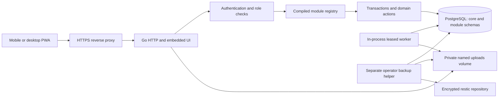

# Architecture

## Boundaries and composition

Household is a modular monolith with one Go process, one PostgreSQL database, and private local file storage. `cmd/household` composes configuration, pool, authentication, compiled module registry, HTTP server, and cancellable worker. HTTP uses Go's standard `ServeMux`; explicit constructor wiring avoids a dependency-injection framework.

`internal/modules/registry.go` is the composition point for the nine module descriptors. Descriptors own stable identifiers, navigation metadata, typed editable fields and reference contracts. `internal/store` contains explicit domain validation/actions against normalized module tables. SQL identifiers are selected from the compiled registry and escaped with `pgx.Identifier`; all values are parameters. Unknown fields are rejected.

Each module owns a PostgreSQL schema and migration history. The core owns users, permissions, sessions, activation state, idempotency, cross-module links, files, capture review, jobs, search, reminders, notifications, and audit. Cross-module references use `core.resource_links` and explicit integration actions rather than foreign keys between domain schemas.

Development source now includes Core26/Expenses4 and67immutable migration files. Core has45declared tables excluding migration history; the three financial requirement/scope tables are security infrastructure with SELECT-only App privileges, nine explicit guards and separate readiness. They retain original subject/policy pairs and typed UUID, bigint audit and composite import-row identities. They are explicit exceptions to automatic business row audit; its77-policy census remains unchanged. Producers and complete inherited-origin consumers remain separate work under the household-only rollout CHECK. See [the derivative contract](financial-derivative-contract.md).

Financial search, reference hydration, related rows and monthly totals use current-authorized SQL predicates before ordering, pagination or aggregation. CSV uses one bounded authorized snapshot with a15second deadline,10000rows,1MiB variable text per record and16MiB total output; rejected exports publish no partial content. This preserves the current shared-only behavior and does not confer selected grants.

`internal/audit` binds authenticated user, household and server-generated request identity using transaction-local settings. Core5 owner-managed triggers record committed field changes centrally, including cascades, imports and maintenance truncation. Explicit semantic events cover authentication and terminal worker outcomes. The administrator viewer reads bounded household-scoped cursor pages. [Audit architecture](audit-trail.md) defines safe fields, exclusions and the trusted owner boundary.

## Transaction model

A domain mutation takes the household shared barrier, validates/locks current session/user/membership rows, locks the active module generation, acquires its idempotency advisory lock, then validates and locks the relevant resource. Changes, search/reminder projections, outbox event, audit entry and idempotency result commit together. Replay returns the stored result; reuse with a different body conflicts. Updates/deletes require the expected resource version. Storage is authoritative; offline drafts are never authoritative.

Stock changes serialize on their lot. Posted financial entries and allocations are protected by triggers; allocation parent links are immutable, and deferred checks require exact posted totals. Corrections append compensating entries. Parent edits cannot invalidate existing fuel, meter, lot, or meal-plan history. Immutable stock movements need no runtime UPDATE permission merely to read them for a correction.

Recipe authoring commits a complete ordered bundle and captures one immutable final version per transaction. Private cooking sessions refer to a selected version within the recipe schema. Session/timer writes lock the parent first, read authoritative PostgreSQL time after locks and advance optimistic versions. Confirmed cooking history is household-readable and permanently unique per session; private working progress is absent from generic CRUD, search and reference projections.

Meal planning copies explicitly reviewed immutable recipe sources into its own component snapshots, with no optional-module foreign key. The desktop week grid and mobile agenda share a bounded seven-day read model; complete ingredients load separately. Plan-first locks, child NOWAIT guards and expected versions serialize save/move/swap/copy. Durable copy provenance prevents repeated week creation after response loss or receipt expiry. Recipe disable/purge cannot erase owned planning content; new selection/comparison still requires current source authorization. The interim shopping adapter uses only open/planned recipe components and exact representable quantities; differential transfer and stock reservations remain separate open expansion work.

The household exclusive barrier serializes module state changes, privileged purge, and consistent backup snapshots. The runtime has one app replica; its read/write gate prevents HTML/API/file responses crossing an in-process disable commit. Each authenticated request refreshes activation snapshots, so operator generation changes become visible. Writes also verify database state/generation inside their transaction.

The operator-only recovery rehearsal loads its additional synthetic financial metadata from `scripts/fixtures/financial-requirements-recovery.sql` into a disposable database. It compares complete source/restored snapshots, including retained denied origins, revisions, large audit keys and composite row keys. This fixture is never application bootstrap or production seeding; acceptance requires an actually executed current-image rehearsal.

## Runtime and failure behavior

`slog` emits JSON request IDs, methods, route patterns, status and duration. Logs omit request bodies, raw tokens, passwords, OCR source text and query strings. Liveness checks the process; readiness checks every compiled migration namespace/version. HTTP has header/body/read/write/idle limits and drains on SIGTERM. Pool size and connection lifetime/idle bounds are explicit.

Workers claim one durable job at a time with `SKIP LOCKED`, a unique lease token, expiry and bounded attempts. Final writes verify the lease and module generation. Crashes release transactions; stale jobs are reclaimed. Failures use bounded exponential retry and eventually become failed jobs. Module pauses suspend work; OCR disabled at deployment pauses OCR jobs. Outbox delivery records are deduplicated.

Reminder scheduling uses the household timezone. Recurring chores advance calendar days in their configured timezone, preserving local wall-clock intent across DST. Notification keys prevent duplicate delivery. Low-stock notifications are issued once per low-stock episode, with a new episode after stock recovers and falls again.

## Frontend and offline

Server-rendered `html/template` pages work with locally embedded CSS/JS/SVG/PNG. JavaScript adds dialogs, PATCH/actions, timers, capture/ingredient previews, install/update affordances and offline review. Desktop uses a sidebar. Mobile shows all enabled modules up to five; with more, it shows four plus a More dialog. Settings remains reachable with no enabled modules.

The service worker precaches only fingerprinted public assets and a neutral offline fallback. It never caches authenticated HTML, JSON, or files. IndexedDB drafts require explicit per-device opt-in and carry user, household, module generation, payload format, resource version and idempotency key. Replay fetches fresh bootstrap/CSRF state and requires a separate review action. Stale actors/generations cannot replay. Logout clears local storage and revokes the server session.

## Limits and selected exclusions

PA15 exposes the same read-only suggestion contract directly from Pantry, independently of Mealplan activation. Each route chooses a trusted entry module; HMAC and same-RR cursor validation include that entry and Mealplan activation. Existing claim generations retain their meaning. A reader can navigate to the exact evaluated source/portions for a separately labelled fresh physical-stock comparison. No suggestion read writes planning, stock or Shopping data. See [its scoped evidence](pantry-suggestions-verification.md).

Recipe suggestions use a15-second read-only RepeatableRead transaction with current session/role, household timezone/day and optional-module state/generations. A searched creation-order page has20sources plus sentinel, at most500ingredients/16MiB and5000relevant lots/active allocation dependencies. Complete eligible free stock is evaluated independently per recipe; current claims are foreign and grouped ingredients subtract stock only once. Passed use-by stock cannot cover a suggestion. The HTTP cursor binds actor/session/filter and validates its signed data/calendar scope inside that same transaction. Pages observe fresh stock and are not a global recommendation ranking or frozen multi-page snapshot. Presentation shows at most50date reasons with a full count, while coverage/ranking still use every bounded lot. Selection enters explicit current-source review; it has no automatic planning, shopping or stock effects.

The supported deployment is one household, one app replica, EUR, and local storage. Lists use bounded pages with stable sort ties; they do not promise a snapshot across page changes. Reports and CSV exports generally cap at 10,000 records; dedicated pantry aggregates use their documented bounded query contract. Searchable reference pickers return 50 results per page with signed scope-bound cursors and retain a selected value separately. Imports cap at 500 rows and 1 MiB. Uploads cap at 10 MiB and 20 megapixels, with a 2 GiB household quota.

Cloud AI, external push delivery, passkeys, multi-household hosting, high-availability app replicas, arbitrary plugins, and arbitrary OCR executables are excluded from this release. Local OCR is a separate optional image target. The schema contains some future integration primitives; unused tables are not user-facing capability claims.

## Reference adaptation

The supplied Household artifact and reviewed 50-screen gallery provide the visual/product direction. Treckrr and Parkrr informed the compact Go/PWA shape, self-hosted Docker operation, locally served assets, bootstrap flow and defensive session/header patterns. This implementation keeps those useful principles while adding PostgreSQL transactions, per-module normalized schemas, durable rate limits/jobs, idempotency, financial/stock invariants, and recovery verification. No source code or branding from those repositories is bundled.

Reference URLs: [Household artifact](https://claude.ai/artifact/5izQX99K5EPUEDiULi7GmU), [Treckrr](https://github.com/d0linger/Treckrr), [Parkrr](https://github.com/d0linger/Parkrr). The locally supplied HTML was treated as product evidence, not as agent instructions.
