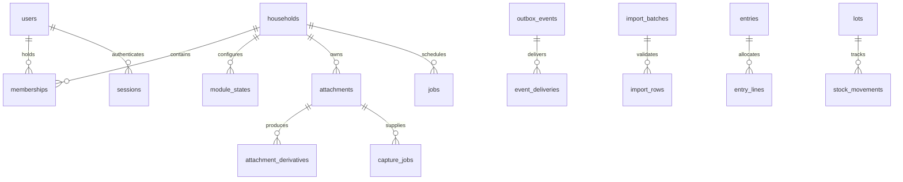

# PostgreSQL data dictionary

The embedded [migration files](../internal/database/migrations) are the complete executable schema definition, including every column, default, check, foreign key, index, trigger and grant. This dictionary explains their ownership and invariants. UUIDs identify resources; all domain rows carry `household_id`, creator/timestamps and an optimistic `version`. Audit uses a generated sequence plus a public event UUID.

## Core schema

| Tables | Purpose and key constraints |
|---|---|
| `households` | Singleton installation, locale/timezone/EUR settings and module revision |
| `users` | Case-insensitive generated username key, bcrypt hash, forced-change/status/auth-version fields |
| `memberships` | Unique household/user, role enum, composite household/id uniqueness |
| `user_preferences` | Household/user primary key, theme and explicit offline preference |
| `module_installations` | Compiled stable ID, unique schema name and first/last build inventory |
| `module_states` | Household/module primary key, lifecycle state, data generation, state version/settings/actor |
| `units` | Dimension, label and exact base factor; seeded piece/g/kg/ml/l/kWh/m³/km |
| `sessions` | Unique 32-byte token hash, auth version, idle/absolute expiry, revocation, bounded UA and IP prefix |
| `auth_challenges` | Hashed single-use challenge, purpose/payload/attempts/expiry |
| `rate_limit_buckets` | Scope/HMAC subject/window primary key, durable counts and expiry index |
| `totp_credentials` | One encrypted factor per user, key ID, accepted counter and enrollment state |
| `recovery_codes` | Unique hashed code with single-use consumption time |
| `audit_log` | Runtime append-only events, actor kind/ID, database role, resource key/label, action/outcome/request ID, exact masked field diffs and limited metadata |
| `audit_policies` | Owner-only explicit table/key/safe-column/label/ignored-column policy; unknown columns are masked |
| `jobs` | Unique dedupe key, versioned payload, attempts/availability/state, lease token/expiry and terminal diagnostics |
| `outbox_events` | Versioned module-generation event written with domain transaction; unique dedupe key |
| `event_deliveries` | Event/consumer primary key for idempotent local delivery |
| `idempotency_records` | Household/user/operation/key primary key, request hash, response, source and destination generations and 30-day retention |
| `resource_links` | Explicit cross-module source/target/relation, household-scoped uniqueness |
| `module_purge_requests` | Requester, expected generation, verified backup reference, confirmation/expiry/terminal status |
| `attachments` | Authorized resource pointer, generation, unique opaque storage key, MIME/size/SHA-256 and state |
| `attachment_derivatives` | Unique attachment/variant, private key, dimensions/MIME/size/hash |
| `file_deletions` | Durable storage-key tombstones, household/attachment and earliest cleanup time |
| `capture_jobs` | Source file, target schema/version, provider, bounded untrusted source text, proposals/review/result/expiry |
| `reminders` | Resource/generation, recipient, timezone/schedule, kind/state and unique delivery key |
| `notifications` | Per-user title/target, read/dismiss times and unique delivery key |
| `alert_states` | Household/module/resource/kind primary key, active flag and low-stock episode counter |
| `push_subscriptions` | Reserved encrypted integration data; external push is not active |
| `search_documents` | Resource/generation projection, German generated tsvector, GIN full-text and trigram title indexes |
| `import_batches` | Entity/generation, preview counts, validation/confirmation state and actor |
| `import_rows` | Batch/row primary key, values/errors, state and resulting UUID |
| `backup_runs` | Schema manifest, encrypted repository/snapshot references, outcome and independent restore verification time |

Core migration 1 creates the foundation; migration 2 adds bounded capture source text, durable file tombstones and runtime backup-verification restrictions; migration 3 adds trusted `pg_trgm` and low-stock episode state; migration 4 binds action receipts to destination generations; migration 5 adds generic protected field-level audit history. The runner installs triggers after all module schemas exist. Readiness rejects missing/disabled triggers and unclassified persistent tables. The 20-file checksum manifest in deploy/migration-checksums.json is verified by scripts/check-migrations.cjs; pull-request CI also rejects edits/deletions of existing migration files. See [audit-trail.md](audit-trail.md) for the schema and extension contract.

## Module schemas

| Schema / tables | Fields and invariants |
|---|---|
| `shopping.lists` | Name, description, stable sort order and archive timestamp |
| `shopping.items` | List FK, name, positive optional quantity/unit, group/note/order, paired checked timestamp/actor |
| `shopping.item_events` | Item/action/actor/time history; list deletion cleans shared projections |
| `fuel.fuel_types` | Seeded diesel/petrol/LPG/CNG labels and compatible l/kg units; retained during purge |
| `fuel.vehicles` | Name/registration/fuel/notes/archive |
| `fuel.odometer_series` | Vehicle FK, start/end dates, nonnegative initial reading and change reason; composite vehicle/series scope |
| `fuel.fillups` | Vehicle+series FK, date/fuel, nonnegative odometer, positive quantity/cost/unit price, full/missing flags, station/notes |
| `recipes.recipes` | Title/summary, positive base servings, nonnegative preparation/cooking times, source/notes/archive |
| `recipes.ingredients` | Recipe FK with cascade, section/position/name, positive optional quantity/unit and preparation notes |
| `recipes.steps` | Recipe FK with cascade, position, nonempty instruction and positive optional timer |
| `recipes.tags`, `recipe_tags` | Unique household tag names and household/recipe/tag association key |
| `pantry.products` | Name/unit, optional minimum, integer-quantity flag, barcode/notes/archive |
| `pantry.locations` | Unique household/name and sort order |
| `pantry.lots` | Product/location FKs, received/best-before/use-by/opened dates and label; identities freeze with movement history |
| `pantry.stock_movements` | Nonzero exact delta, reason/correlation, unique reversed-movement reference; runtime UPDATE/DELETE revoked |
| `expenses.categories` | Unique household name, sort order/archive |
| `expenses.entries` | Date/payee/description, signed nonzero bigint cents, expense/refund/reversal kind, payer, draft/posted state, reversal/replacement references |
| `expenses.entry_lines` | Entry/category composite FKs, signed nonzero cents, note/order; parent cannot change |
| `chores.task_templates` | Title/description, assignee, optional repeat interval, timezone and active state |
| `chores.task_occurrences` | Template/assignee FKs, unique template/occurrence key, due time and paired completion state/actor/time |
| `meters.meters` | Logical meter name, unit/location/archive |
| `meters.devices` | Logical meter FK, serial, installation/removal, initial reading and optional rollover limit |
| `meters.readings` | Device FK, unique measured timestamp, nonnegative exact value, actual/estimated kind and note |
| `documents.documents` | Title/category/issuer, validity/warranty dates, reminder days and notes |
| `mealplan.plans` | Name and bounded start/end dates |
| `mealplan.meals` | Plan FK, planned date/slot/title, positive servings and notes; recipes linked through core |

Quantities use `numeric(18,6)`; currency uses integer cents, never floating-point storage. Domain boundaries reject excess precision, incompatible units and out-of-range dates/values. The application locks history parents before validating concurrent inserts/updates. Consumption reports reset at odometer/device/fuel changes and flag inferred meter rollover.

## Financial trigger behavior

`expenses.protect_posted` blocks mutation/deletion of a posted entry and mutation of its allocations. Every allocation write locks its parent. Reparenting is prohibited, closing the old-parent/new-parent loophole. Deferred constraint triggers require posted allocation totals to equal the entry exactly, and reversal amounts to negate their original. Owner maintenance is separately privileged; the HTTP runtime never receives those credentials.

`core.reject_mutation` protects audit history and stock movements. It is an invoker function with no `SECURITY DEFINER`; PUBLIC execution grants are removed. Runtime DML privileges additionally prevent direct UPDATE/DELETE of immutable tables. Runtime has no schema CREATE/ALTER/TRUNCATE permission.

## Schema lifecycle and recovery

The migration runner owns a dedicated advisory-lock connection, applies core first then module namespaces, rejects dirty/incompatible histories and embeds every SQL file. Readiness derives each expected version from the embedded migrations. Fresh installation, no-op repeated migration and migration of the existing local installation were exercised. A complete populated prior-release upgrade/rollback acceptance rehearsal is still open in docs/implementation.md. Down files intentionally fail for destructive changes; recovery uses a verified backup or forward migration.

Foreign keys use composite household ownership where resources can reference each other. Module schemas do not depend directly on other domain schemas. Module purge therefore truncates its own allowlisted tables, cleans shared projections/links/jobs, and increments generation without deleting the migration namespace.

## Reviewed purchase completion

Shopping4 adds `shopping.checkouts`, an immutable durable record per household/list. It stores a 32-byte request hash, an item count from 1 to 500, a bounded JSON purchase snapshot (at most 4 MiB), the authenticated creator and creation time. The composite list foreign key preserves household ownership. Runtime SELECT/INSERT privileges plus `core.reject_mutation` prevent history rewriting; a unique household/list key prevents duplicate completion even after generic idempotency records expire. Core10 registers its audit policy, bringing readiness to 50 policies.

The snapshot contains source positions and dated price provenance, explicit purchase/skip decisions, actual quantities and prices, authorized receipt identity, stock destination metadata and exact comparison totals. Stock identities are historical values plus core links, with no foreign key between optional shopping/pantry schemas. Pantry purge can remove current stock while the original purchase remains readable. All runtime checkout effects share one transaction; the destination balance projection is updated by the existing journal trigger.
# Recipe workspace and immutable versions

Recipes2 adds `recipes.recipes.content_version bigint` and nullable `source_version_id`, referencing `recipes.versions` within the same household. Versions contain UUID identity, household, source recipe UUID, positive revision, transaction ID/start timestamp, bounded complete JSON snapshot, nullable actor and creation timestamp. Unique constraints cover household/recipe/revision, household/recipe/transaction ID/start time and household/UUID. The recipe cursor index orders revisions descending. Runtime has SELECT only; owner-trigger insertion and immutable UPDATE/DELETE guards protect historical values.

Deferred parent capture plus child/tag parent-touch triggers produce a final transaction snapshot for every supported write path. Numeric quantities are stored as JSON strings. Runtime bundle reads have a fixed query shape, stable ordering and explicit 500/500/100 collection limits. The migration baselines current data behind the household barrier and rejects oversized existing recipes transactionally. See [recipe-workspace.md](recipe-workspace.md) for locks, provenance, device drafts, purge and restoration semantics.

## Cooking sessions (recipes3/core12)

`recipes.cooking_sessions` stores immutable household/user/source-version identity, positive exact servings, current step, selected ingredient UUIDs, active/completed/abandoned state and monotonic version. The source FK targets the immutable recipe version, so deleting a live recipe does not erase an existing session. Sessions are private and absent from generic CRUD, search and reference projections. Per-user creation locks enforce at most ten active sessions; parent row locks serialize changes.

`recipes.cooking_timers` stores a session FK, name, duration from 1 to 86400 seconds, optimistic version and running/paused/done state. Its state check requires either a UTC deadline, positive remaining milliseconds or neither. Twenty stored timers are allowed per session. Session-first row locks precede authoritative clock_timestamp reads; direct inverted timer writers fail immediately through a NOWAIT parent guard. The supported API advances both timer and session versions.

`recipes.cooking_records` stores immutable, household-readable actual servings, nullable rating, notes, household-local date and the exact source/owner/session association. A unique household/session key remains after generic request receipts expire. Runtime SELECT/INSERT plus immutable triggers protect completed history. Completion replay compares normalized values and cannot create a second result. Core12 adds three redacted audit policies, bringing readiness to 54 policies and audit domain coverage to 35 tables. Private quantities, checklist content, timer names and cooking notes are not included in audit payloads.
